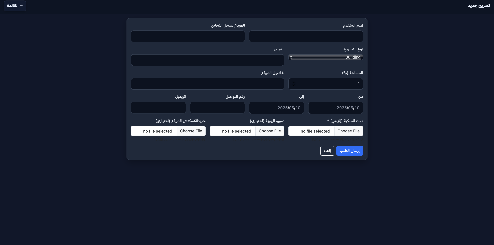

# Land Use Permit Management System  
**Full-Stack Web Application (Spring Boot + React + PostgreSQL + Docker)**  

A comprehensive system for managing **land use permits**, enabling users to apply for various types of land use requests (Building, Agricultural, Commercial Event, etc.), upload documents, and track their application status — while admins review, approve, or request edits through an interactive dashboard.

Developed by **Rayan Saleh Al-Dwlah** as part of the **InnovationTeam Internship Program**.

---

## 🚀 Key Features

### 👤 User Side
- Secure login using Basic Authentication  
- Submit land use permit requests  
- Upload ownership proof, ID copy, and site map  
- Track application status (Pending / Approved / Rejected / Edit Requested)  
- Edit and re-submit applications if requested by admin  

### 🧑‍💼 Admin Side
- Manage all submitted permits (view, approve, reject, request edits)  
- Download and view uploaded attachments  
- View analytics and permit distribution through a dashboard  

---

## 🏗️ Tech Stack

| Layer | Technologies |
|-------|---------------|
| **Frontend** | React (Vite), Axios, Bootstrap, Chart.js |
| **Backend** | Spring Boot (Java 17), Spring Security, JPA / Hibernate |
| **Database** | PostgreSQL |
| **Authentication** | HTTP Basic Authentication |
| **Deployment** | Docker & docker-compose |
| **Version Control** | Git / GitHub |

---

## 📸 Screenshots

| Login | Admin Dashboard | New Permit | Permit Review |
|--------|----------------|-------------|----------------|
|  |  |  |  |

---

## 🗂️ Repository Structure
```bash
Land-Use-Permit-System/
│
├── backend/
│   ├── src/main/java/com/landuse/app/
│   │   ├── config/            # Security & Data initialization
│   │   ├── controller/        # REST Controllers (Auth, Permit, Admin)
│   │   ├── dto/               # Data Transfer Objects
│   │   ├── entity/            # Entities: User, Permit, Attachment
│   │   ├── enums/             # RoleType, PermitType, PermitStatus
│   │   ├── exception/         # Global exception handling
│   │   ├── repository/        # JPA repositories
│   │   ├── security/          # Spring Security configuration
│   │   ├── service/           # Business logic
│   │   └── util/              # Constants and helpers
│   │
│   ├── resources/
│   │   ├── application.properties
│   │   ├── application-prod.yml
│   │   └── static/, templates/
│   │
│   ├── uploads/               # Uploaded permit files
│   ├── Dockerfile             # Backend Docker configuration
│   └── pom.xml                # Maven dependencies
│
├── frontend/
│   ├── src/
│   │   ├── components/        # Shared components (Navbar, Sidebar, etc.)
│   │   ├── pages/             # Pages: Login, Dashboard, Analytics, etc.
│   │   ├── services/          # API service layer (Axios)
│   │   ├── assets/            # Static assets and icons
│   │   ├── App.jsx / main.jsx
│   │   └── styles.css
│   │
│   ├── public/
│   ├── Dockerfile             # Frontend Docker configuration
│   ├── nginx.conf             # NGINX reverse proxy
│   ├── vite.config.js         # Vite configuration
│   └── package.json
│
├── docker-compose.yml         # Combine frontend & backend
├── README.md                  # Documentation
└── LICENSE                    # Project license
```
---

## 🧩 Core Functionalities

| Module | Description |
|---------|-------------|
| **Authentication** | Basic Auth via Spring Security |
| **Permit Submission** | User form with backend validation |
| **File Uploads** | Multi-file support per permit (PDF/JPEG) |
| **Permit Management** | Admin actions: approve, reject, request-edit |
| **Edit Flow** | User can modify and re-submit requests |
| **Analytics** | Admin dashboard with charts and stats |

---
## 🧑‍💻 Author

**Rayan Saleh Al-Dwlah**  
🎓 Computer Science Student @ King Khalid University  
🔗 [LinkedIn](https://www.linkedin.com/in/rayan-saleh-b12a3132a/)  
🔗 [GitHub](https://github.com/RayanAlDwlah)

---

## 🏷️ License

This project is licensed under the **MIT License** — feel free to use it for research or educational purposes.

