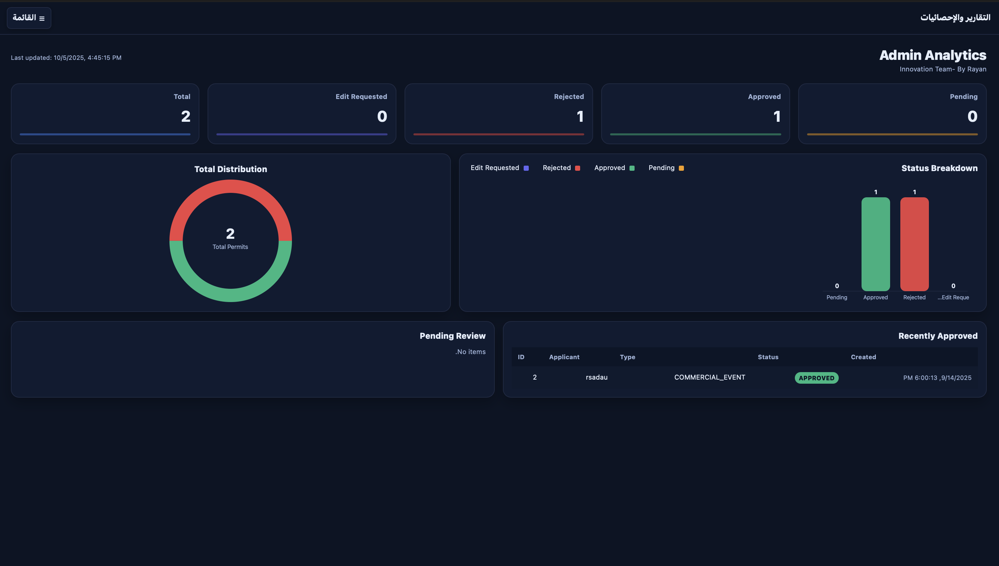
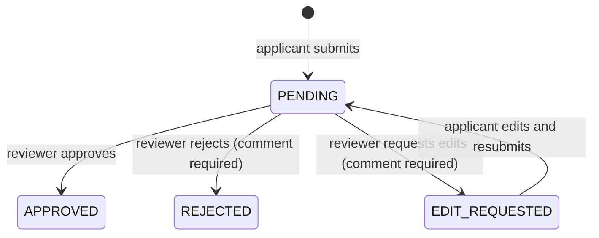
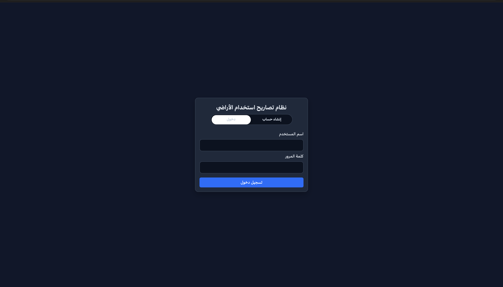
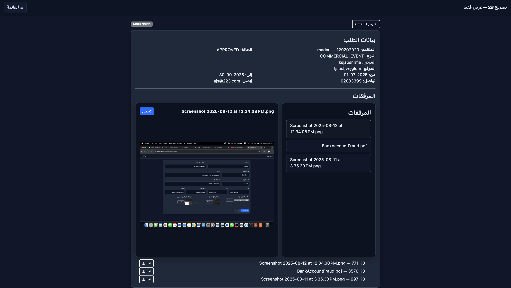
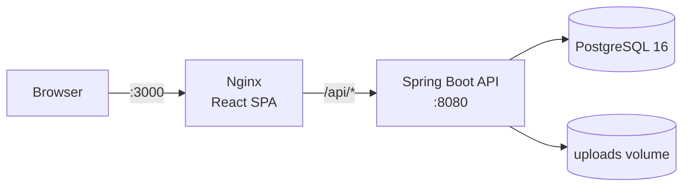

# Land Use Permit Management System

A full-stack web application where applicants submit land-use permit requests with supporting documents and reviewers approve, reject, or send them back for edits.

   



## Overview

This was the final deliverable of a Full-Stack Development internship at InnovationTeam (Riyadh, Jul–Sep 2025). It models a government land-use permit workflow: an applicant files a request (building, agricultural, commercial event, or other), attaches an ownership deed, ID copy, and site map, and follows its status. A reviewer works through the queue and either approves it, rejects it with a reason, or returns it for edits. The work is in the parts a form-and-table app usually skips: stateless JWT authentication with two roles, per-record ownership checks on every permit and file, a guarded edit-and-resubmit loop, and a file-upload path that does not trust the client. The interface is in Arabic (right-to-left). It was built and run locally; it was not deployed to real users.

## What is in it

Counts measured from the current code:

- **22 REST endpoints** across 5 Spring controllers (`Auth`, `Permit`, `Admin`, `Attachment`, `User`). Twenty-one were written during the internship; the paginated admin list was added on 2025-09-14.
- **3 JPA entities** (`User`, `Permit`, `Attachment`) on PostgreSQL 16.
- **9 React pages**: login/register, applicant dashboard, my permits, new permit, upload attachments, admin dashboard, permit review, read-only permit view, analytics.
- **3 containers** in Docker Compose: PostgreSQL, the Spring Boot API, and Nginx serving the built React app.

### Permit workflow



- An applicant can edit a permit only while it is in `EDIT_REQUESTED`; the service rejects the update in any other state, and a successful edit returns the permit to `PENDING`.
- Approve, reject, and request-edit are allowed only while a permit is `PENDING`. Acting on a decided permit returns `409 Conflict`.
- Self-registration always creates an applicant account (`ROLE_USER`); a role sent by the client is ignored, and reviewer accounts are provisioned separately.
- Reject and request-edit require a non-blank reviewer comment, checked in both the controller and the service.

## Screenshots

The admin analytics dashboard is shown at the top. The other screens:

| Sign in | New permit request | Permit preview with attachments |
|---|---|---|
|  |  |  |

## How it works



- **Backend (Spring Boot 3.5.4, Java 21).** Layered: controllers, services, Spring Data JPA repositories, DTOs, and a global exception handler. Passwords are hashed with BCrypt.
- **Authentication.** `POST /api/auth/login` returns an HS256 JWT (jjwt 0.11.5). A custom `OncePerRequestFilter` validates the token on each request; sessions are stateless.
- **Authorization in two layers.** Role checks (`ROLE_USER`, `ROLE_ADMIN`) in the security filter chain and with `@PreAuthorize`, plus ownership checks in the services so an applicant can only read, edit, or download their own permits and files.
- **File uploads.** PDF, JPEG, and PNG only, checked by both content type and file extension. File names are cleaned and length-limited, files are stored under a UUID, and downloads go through an authenticated endpoint that repeats the ownership check. Limits: 15 MB per file, 100 MB per request.
- **Frontend (React 19, Vite 7, React Router 7, Bootstrap 5).** Calls the API with `fetch`. The analytics page draws its donut and bar charts as hand-written SVG. If the summary endpoint fails or returns all zeros, it rebuilds the per-status counts from the paginated permit list.
- **Deployment.** Multi-stage Dockerfiles for both apps. Compose starts the backend only after the PostgreSQL healthcheck (`pg_isready`) passes. Nginx serves the SPA and proxies `/api/` to the backend.

### API

| Area | Endpoints |
|---|---|
| Auth | `POST /api/auth/register`, `POST /api/auth/login`, `GET /api/auth/me` |
| Applicant permits | `POST /api/user/permits`, `GET /api/user/permits`, `GET /api/user/permits/{id}`, `PUT /api/user/permits/{id}` (resubmit after edit request) |
| Reviewer | `GET /api/admin/permits`, `GET /api/admin/permits/page?status=&page=&size=`, `GET /api/admin/permits/{id}`, `PUT /api/admin/permits/{id}/approve`, `PUT /api/admin/permits/{id}/reject`, `PUT /api/admin/permits/{id}/request-edit`, `GET /api/admin/reports/summary` |
| Attachments | `POST`/`GET /api/user/permits/{permitId}/attachments`, `POST`/`GET /api/admin/permits/{permitId}/attachments`, `GET /api/attachments/{attachmentId}/download`, `DELETE /api/user/attachments/{attachmentId}`, `DELETE /api/admin/attachments/{attachmentId}` |
| Other | `GET /api/user/dashboard` (placeholder) |

## Repository layout

```
.
├── BackEnd/Land Use Permit Management System/   Spring Boot API (Maven)
│   ├── Dockerfile
│   ├── pom.xml
│   └── src/main/java/com/landuse/app/
│       ├── config/        security config, seed accounts
│       ├── controller/    5 REST controllers
│       ├── dto/  entity/  enums/  repository/
│       ├── exception/     global exception handler
│       ├── security/      JWT filter and token utility
│       ├── service/       permit workflow, attachments, auth
│       └── util/
├── FrontEnd/landuse-frontend/                   React SPA (Vite)
│   ├── Dockerfile
│   ├── nginx.conf
│   └── src/  components/  context/  pages/  services/
├── docs/screenshots/
├── docker-compose.yml
└── .env.example
```

## Run it

Requires Docker with the Compose plugin.

```bash
cp .env.example .env      # then set POSTGRES_PASSWORD and APP_JWT_SECRET (32+ characters)
docker compose up --build
```

- App: http://localhost:3000
- API: http://localhost:8080 (health check at `/actuator/health`)
- PostgreSQL: `localhost:5433`

On first start the backend seeds one reviewer account and one applicant account; the usernames and passwords are in `config/DataInitializer.java`. They are for local testing only.

## Limitations and next steps

- **No optimistic locking.** Two reviewers acting on the same pending permit at the same moment are not detected; a version column on `Permit` would close that gap.
- **Seed accounts use fixed passwords** in source. They should come from environment variables or be removed outside local use.
- **Testing is minimal.** The only test is a Spring context-load test, and there is no CI. Service-level tests for the workflow and the ownership checks are the first thing to add.
- The upload type check relies on the client-reported content type and the file extension; it does not inspect file contents.

---

Built by Rayan Saleh Al-Dwlah · [LinkedIn](https://www.linkedin.com/in/rayanaldwlah)
